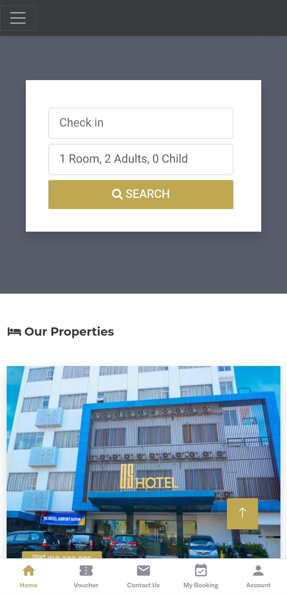

# ORANGESKY.ID — APK ringan untuk orangesky.id

Pembungkus WebView untuk https://orangesky.id/ yang dibuat seringan mungkin: tanpa
AppCompat, tanpa library splash, APK di-minify R8, dan WebView dioptimalkan supaya
cold start terasa seperti membuka website langsung di browser.

## Tangkapan layar

<p align="center">
  
</p>

## Download

Ambil APK terbaru di halaman **Releases**:

**https://github.com/luqman-hakiem/orangesky-app/releases/latest**

File: `OrangeSky.id 1.6.1.apk` (Android 8.0 ke atas).

Download langsung:
**https://github.com/luqman-hakiem/orangesky-app/releases/latest/download/OrangeSky.id.1.6.1.apk**

Cek keaslian file (SHA-256, 141.057 byte):

```
622930254ECB76A6516BCE4C4898BC7BCF6D45DDDD3FB0D38D3E519449B489ED
```

Cara pasang:

1. Download APK di HP Android.
2. Buka file APK, lalu izinkan **Install unknown apps** untuk browser/file manager
   yang dipakai.
3. Setelah terpasang, buka **ORANGESKY.ID**.

> Sejak versi 1.4 semua rilis ditandatangani dengan kunci tetap, jadi pembaruan
> berikutnya bisa langsung dipasang menimpa versi lama tanpa uninstall. Satu kali
> uninstall hanya diperlukan kalau di HP masih ada versi 1.3 atau lebih lama.

## Yang membuat APK ringan

- **Tanpa AppCompat & library splashscreen** — hanya `activity-ktx` + `SwipeRefreshLayout`.
  Startup lebih cepat, dependensi dan ukuran APK lebih kecil.
- **Splash bawaan** — Android 12+ memakai splash sistem; Android lama memakai
  `windowBackground` (navy + wordmark) yang langsung tampil tanpa delay.
- **R8 + shrinkResources** di build release — kode & resource tak terpakai dibuang.
- **WebView hemat** — autoplay video dimatikan, timer/animasi di-pause saat app di
  belakang, cache browser dipakai, file/content access dimatikan.
- **Renderer crash tidak bikin app mati** — WebView dibuat ulang otomatis.
- **Link `target="_blank"`** tetap terbuka di dalam app.
- **Ikut ukuran layar & ukuran font sistem** — konten memakai viewport situs, bisa
  cubit (pinch) untuk zoom, dan teks ikut Setelan > Tampilan > Ukuran font.
- Pull-to-refresh, tombol back, halaman offline, upload file, dan link
  WA/IG/YouTube/tel/mailto tetap jalan seperti sebelumnya.

## Tampilan ala aplikasi

App punya **bottom navigation** sendiri di bawah WebView, seperti desain `utama.png`:

| Tab | Tujuan |
| --- | --- |
| Beranda | `https://orangesky.id/` |
| Voucher | `https://orangesky.id/?menu=voucher` |
| Bantuan | `https://orangesky.id/?menu=contactUs` |
| Booking | `https://orangesky.id/login/?from=mybooking` (area akun; daftar booking muncul setelah login) |
| Akun | `https://orangesky.id/login/` |

- **Pill melayang**: `LinearLayout` + ikon vektor 24dp + label 11sp, sudut 24dp,
  margin 12dp, shadow halus, tanpa library navigasi tambahan.
- Tab aktif mengikuti URL (gold gelap `#8A6D1F` yang kontras 4,9:1 di putih,
  sisanya abu-abu), dengan pill indikator, animasi 180ms, dan getar halus.
- Label pendek (Beranda/Voucher/Bantuan/Booking/Akun) supaya tidak berdesakan di
  layar 360dp maupun saat ukuran font sistem diperbesar.
- Bottom bar otomatis hilang saat konten di-scroll ke bawah dan muncul lagi saat
  di-scroll ke atas — hanya di Beranda & Voucher. Di halaman booking/form bar
  selalu tampil supaya tombol aksi tidak hilang. Ketuk area bawah untuk
  memunculkannya lagi.
- Posisi scroll tiap tab diingat; kembali ke Voucher tidak mulai dari atas.
  Menekan tab yang sedang aktif = gulir ke atas (tidak reload).
- Menu di header situs (Home/Voucher/Contact/Currency/Login) disembunyikan supaya
  tidak dobel dengan bottom bar; navigasi sepenuhnya lewat bottom bar app.
- Tombol panah ke atas bawaan situs di kanan bawah juga disembunyikan.
- Isi halaman tetap 100% situs orangesky.id; yang ditambahkan app hanya bilah bawah ini.

### Perbaikan tampilan halaman (CSS/JS ringan, tanpa ubah backend)

- **Garis progres gold 2dp** di bawah status bar saat halaman dimuat + fade-in 120ms.
- **Kontras**: teks gold di atas putih memakai `#8A6D1F`; tombol outline ikut disesuaikan.
- **Harga & tanggal konsisten**: `IDR 690.000` → `Rp690.000`, `09/11/2025` → `9 Nov 2025`.
- **Voucher**: toolbar cari + urut (Default / Segera berakhir / Nama A-Z), chip
  kategori lengket dan bisa digeser, S&K dilipat 2 baris dengan tombol buka/tutup,
  muat lebih banyak per 12 kartu, dan akses **Merchant**.
- **Footer** diringkas: hanya tautan Merchant yang tersisa karena menu lain sudah
  ada di bottom bar.
- **Halaman offline** bernuansa navy + wordmark gold, dengan tombol Coba lagi dan
  WhatsApp (bukan oranye generik).

## Ukuran layar, kepadatan, dan font

App ini hanya membungkus situs, jadi tata letak utama mengikuti CSS responsif
orangesky.id (`<meta name="viewport" content="width=device-width, initial-scale=1.0">`).
Yang diatur di sisi app:

- `useWideViewPort` + `loadWithOverviewMode` — WebView memakai lebar layar sebagai
  lebar layout, lalu situs memilih breakpoint-nya sendiri (Bootstrap: 576/768/992/1200 px).
- `textZoom` diambil dari `Configuration.fontScale` (dibatasi 85–200%), jadi pengaturan
  **Ukuran font** Android ikut terpakai. Perubahan font ditangani lewat
  `onConfigurationChanged` tanpa reload halaman.
- `configChanges` memuat `orientation|screenSize|smallestScreenSize|screenLayout|fontScale`,
  jadi rotasi, split-screen, dan lipat/buka foldable tidak memuat ulang halaman.
- `resizeableActivity=true` — siap untuk multi-window dan layar besar.
- Semua tampilan app (spinner, splash, status bar) memakai satuan dp/warna, bukan
  ukuran piksel tetap, sehingga menyesuaikan kepadatan layar.
- Pinch-to-zoom aktif (tombol zoom disembunyikan) untuk pengguna yang butuh teks lebih besar.

Sudah diuji dengan emulasi lebar layar 320–1280 dp (termasuk landscape 844×390):
tidak ada overflow horizontal (`scrollWidth == viewport`) dan navbar berubah jadi menu
hamburger di bawah 992 px.

## Build sendiri

Build otomatis lewat GitHub Actions (tanpa Android Studio):

1. Buka tab **Actions > Build APK > Run workflow** (atau push ke `main`).
2. Download artifact **orangesky-apk**. Isinya:
   - `release/app-release.apk` — **pakai ini**, sudah di-minify (paling kecil & cepat).
   - `debug/app-debug.apk` — untuk uji coba/debug.
3. Artifact **orangesky-aab** berisi `app-release.aab` untuk diunggah ke Google Play
   (lihat `store/UPLOAD-GUIDE.md`).

## App Links (tautan langsung ke app)

Manifest sudah menerima `https://orangesky.id/...` dan `https://www.orangesky.id/...`.
Supaya Android memverifikasinya (tanpa dialog pilih aplikasi), server harus menyediakan:

```
https://orangesky.id/.well-known/assetlinks.json
```

Isinya (ganti `package_name` bila perlu):

```json
[{
  "relation": ["delegate_permission/common.handle_all_urls"],
  "target": {
    "namespace": "android_app",
    "package_name": "id.orangesky.app",
    "sha256_cert_fingerprints": [
      "DF:BFF1:CB:A5:E6:DA:22:45:07:FD:09:64:3D:97:57:25:24:C5:04:8C:7C:29:B3:F5:CB:D8:3A:3C:08:93:BC"
    ]
  }
}]
```

Selama berkas itu belum ada, tautan tetap terbuka di browser seperti biasa.

## APK release bertanda tangan sendiri (untuk dibagikan / Play Store)

Build release tanpa keystore otomatis ditandatangani dengan debug key, jadi cukup
untuk dibagikan langsung tetapi **tidak bisa update** kalau key berubah dan tidak bisa
dipakai ke Play Store.

1. Buat keystore SEKALI saja (simpan file + password di tempat aman):
   ```
   keytool -genkeypair -v -keystore orangesky.jks -alias orangesky -keyalg RSA -keysize 2048 -validity 10000
   ```
2. Ubah keystore jadi teks base64:
   - Mac/Linux: `base64 -w0 orangesky.jks`
   - Windows PowerShell: `[Convert]::ToBase64String([IO.File]::ReadAllBytes("orangesky.jks"))`
3. Di GitHub: **Settings > Secrets and variables > Actions > New repository secret**,
   isi 4 secret: `KEYSTORE_BASE64`, `KEYSTORE_PASSWORD`, `KEY_ALIAS` (contoh: orangesky),
   `KEY_PASSWORD`.
4. Jalankan **Actions > Build APK** lagi. Release APK akan ditandatangani dengan
   keystore tersebut.

Jangan upload file `.jks` ke repo.

## Catatan

- Ganti URL di `MainActivity.kt` (`homeUrl`) kalau domain berubah.
- Naikkan `versionCode` di `app/build.gradle.kts` setiap rilis update.
- Ikon & splash memakai wordmark resmi orangesky.id (`logo_orangeskyid.png`, gold di
  navy). Foreground ikon berupa WebP lossless satu densitas (xxxhdpi) supaya APK tetap
  kecil (~11 KB); Android menyesuaikan sendiri untuk layar lain.
